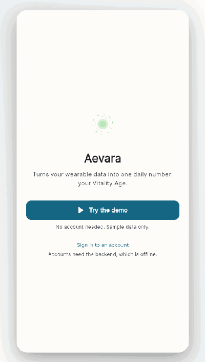
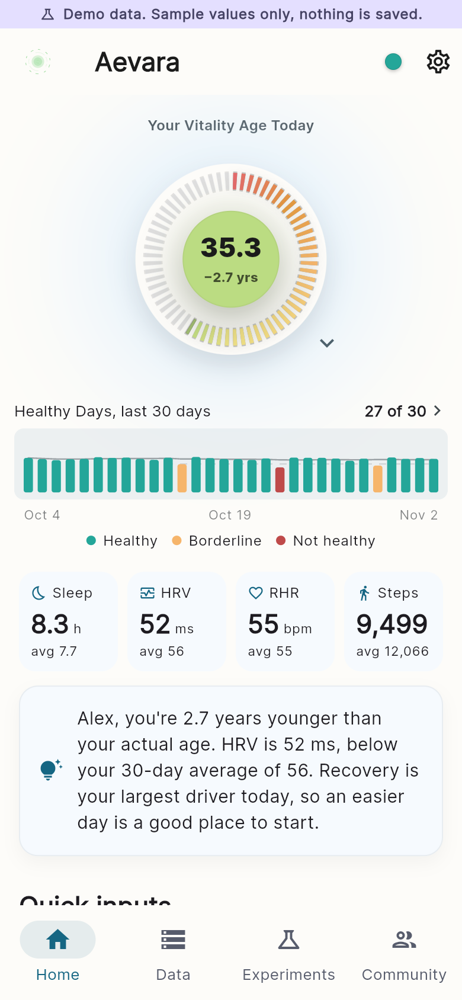
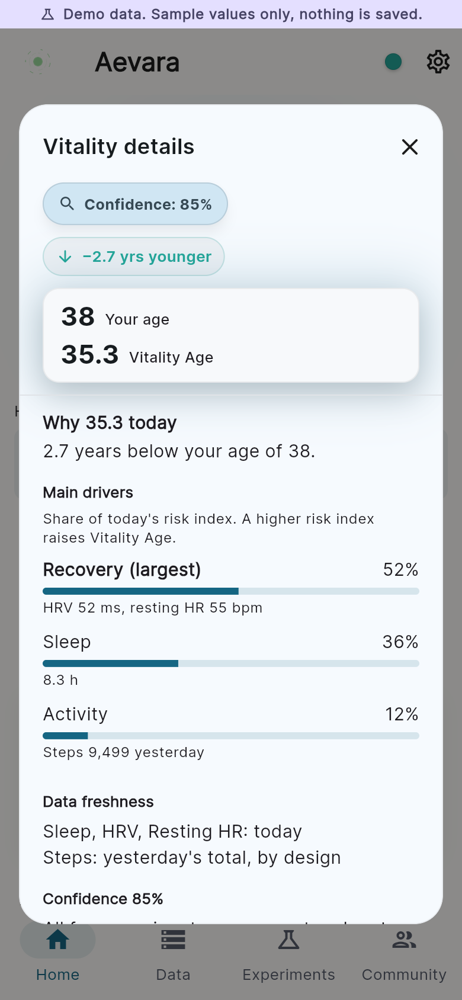
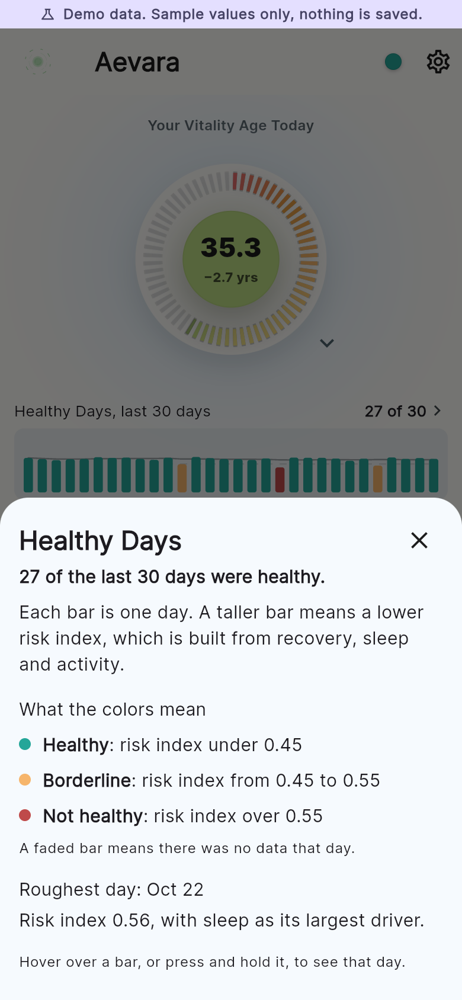
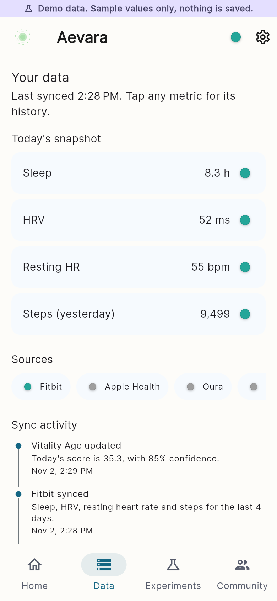
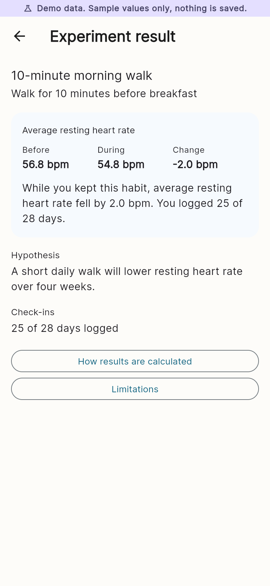
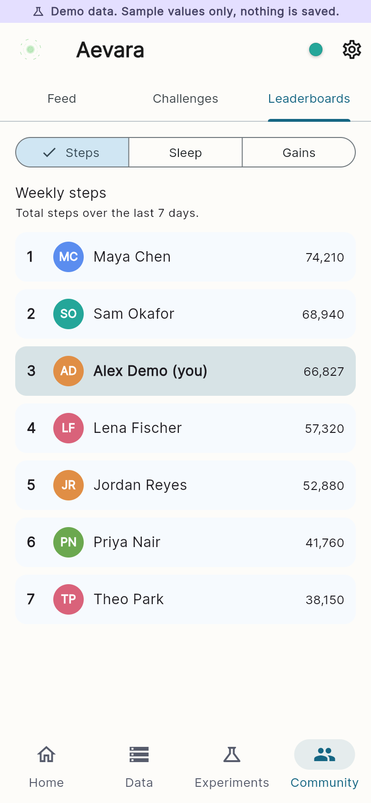

# Aevara

**Live demo: [aevara-demo.web.app](https://aevara-demo.web.app)** (click "Try the demo", no account needed)

Aevara is a health tracking app that turns wearable data into one daily number, your Vitality Age, and shows how it changes over time.

> **Backend status:** the production backend is offline for cost reasons. The live demo uses anonymous sign-in and sample data, labeled "Demo data" on every screen, and nothing you do in it is saved.



## What I built

- **Vitality Age dashboard:** a ring showing today's score, the gap from your actual age, a confidence rating and a 30-day Healthy Days chart, with a breakdown of what drove the score and trend views over 14 to 90 days.
- **Scoring engine:** a server-side daily calculation that combines recovery, sleep and activity into a risk index. It handles missing data with confidence scoring, uses smoothed averages and caps on daily change, and calibrates a personal baseline over the first 14 days.
- **Wearable connections:** a connect flow for eight providers, with Fitbit fully integrated: OAuth, token refresh, a daily sync job, backfill of recent days and disconnect. The other seven are marked "Coming soon".
- **Backend jobs:** scheduled functions that finalize each day's score, advance calibration, sweep for new wearable data, build a weekly steps leaderboard and clean up expired data exports. Firestore triggers maintain usernames and community counters.
- **Account features:** email sign-up with verification, onboarding, profile, notifications and user data export.
- **Coaching text:** daily messages written from templates using the day's numbers. No AI model is involved.
- **Demo mode:** a compile-time flag adds anonymous sign-in with sample data. The sample scores come from a demo-only port of the server's formulas, and a test feeds the same inputs through the real server functions to confirm they match. Security rules stop anonymous visitors from writing data or reading other users' data.

Data, Experiments and Community are front-end features shown in demo mode on sample data; they aren't connected to the backend yet. See [KNOWN_ISSUES.md](KNOWN_ISSUES.md) for one open scoring question.

## Engineering highlights

- **Node 20 to 22 migration:** moved all 30 Cloud Functions to Node.js 22 and tested the main paths in the emulators. They haven't been redeployed, because the backend is staying offline for now.
- **Emulator test suite:** exercises HTTP endpoints, Firestore triggers and scheduled jobs in local emulators, with Fitbit and Cloud Storage faked, so nothing can reach production.
- **Fitbit OAuth hardening:** the user a connection belongs to now comes only from a server-signed, one-time state or a verified Firebase ID token, covered by 76 auth tests.
- **Production outage diagnosis:** traced a full backend outage to a closed billing account using billing records and Cloud Run logs.

## Screenshots

| Home | Why this score | Healthy Days |
|---|---|---|
|  |  |  |

| Data | Experiment result | Leaderboard |
|---|---|---|
|  |  |  |

Desktop and dark theme versions are in [docs/screenshots](docs/screenshots). All values shown are sample data.

## Tech stack

- **App:** Flutter and Dart, with Riverpod for state management
- **Backend:** Firebase Authentication, Cloud Firestore, Cloud Storage, Hosting and App Check
- **Server code:** Cloud Functions (2nd gen) in JavaScript on Node.js 22, including HTTP, callable, scheduled and Firestore-triggered functions
- **Integrations:** Fitbit Web API

## Project layout

```
lib/
  features/     one folder per feature (home, auth, onboarding, sync, settings and more)
  state/        Riverpod providers
  data/         services, models and sample data
  core/         environment, guards and shared widgets
  routing/      routes
  charts/       chart widgets
functions/
  ddc/          daily scoring engine
  vendor/       Fitbit OAuth and data sync
  community/    usernames, counters and leaderboards
  exports/      user data export and cleanup
  test/         auth tests
tools/
  emulator_test/  emulator test suite
firestore.rules, storage.rules, firestore.indexes.json
```

## Testing

```bash
# App tests, including the check that demo scores match the server's functions
flutter test

# 76 Fitbit OAuth and scheduler auth tests. Everything external is stubbed.
cd functions && npm ci && node --test test/auth_paths.test.mjs

# Emulator suite against a commit. Needs bash, the Firebase CLI and Java 21 or newer.
tools/emulator_test/run.sh HEAD
```

## Running it yourself

This repo doesn't include any Firebase configuration or secrets, so you'll need your own Firebase project with Anonymous sign-in enabled. `lib/firebase_options.dart` is only a placeholder until you run `flutterfire configure`. Don't commit the generated file.

```bash
flutter pub get
flutterfire configure
flutter run -d chrome --dart-define=DEMO_ENABLED=true
```

Leave out `DEMO_ENABLED` to build the app without demo mode. Without it, the app needs the deployed backend, which means adding your own `firebase.json`. Deploying the functions requires Firebase's pay-as-you-go Blaze plan.

## Credits and license

The coach avatar animation is from [LottieFiles](https://lottiefiles.com). Wearable brand logos aren't included, so providers use generic icons. The code is under the [MIT License](LICENSE).
